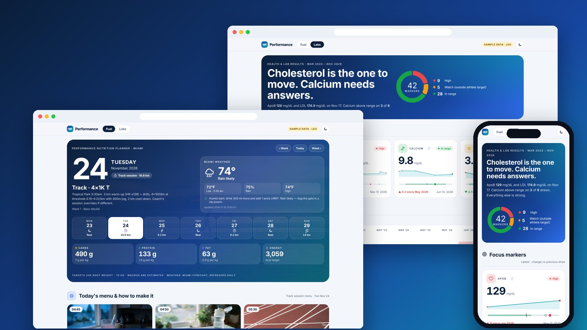
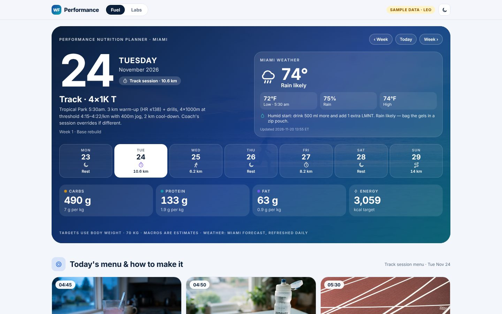
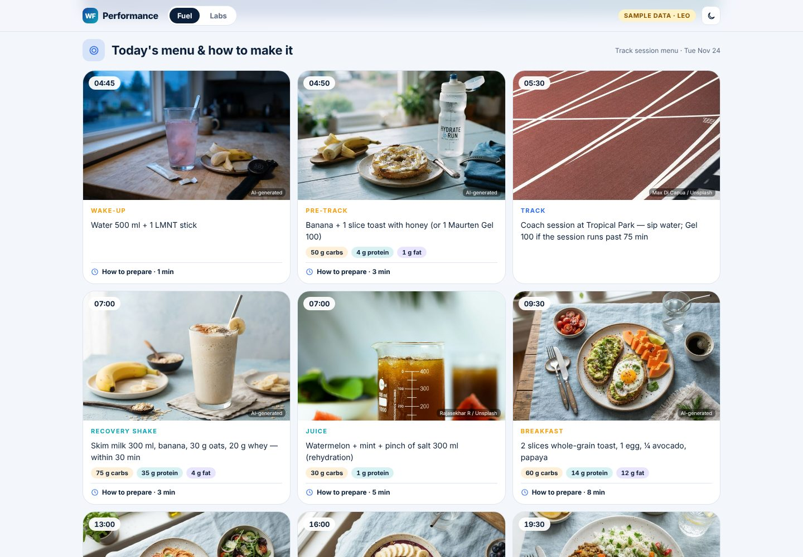
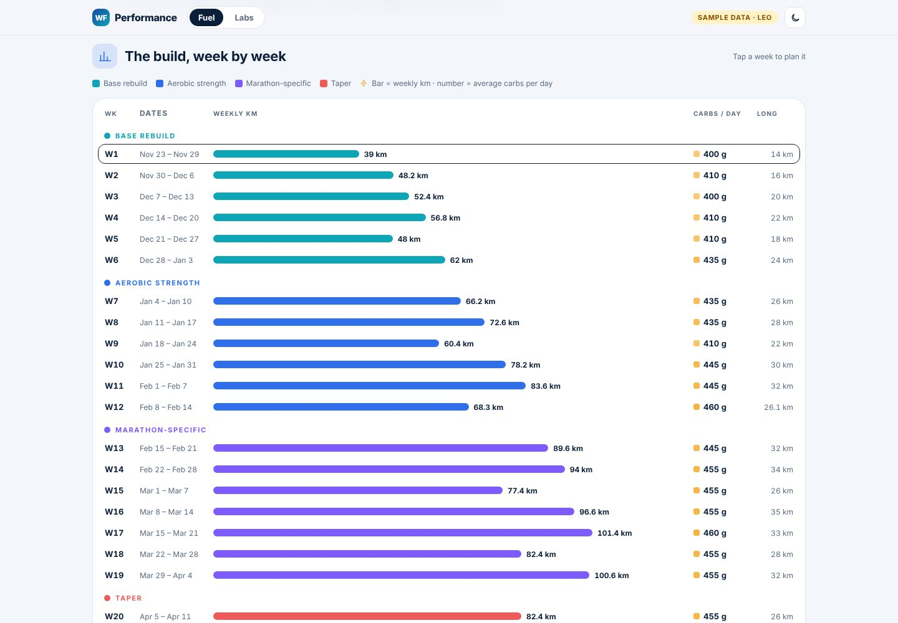
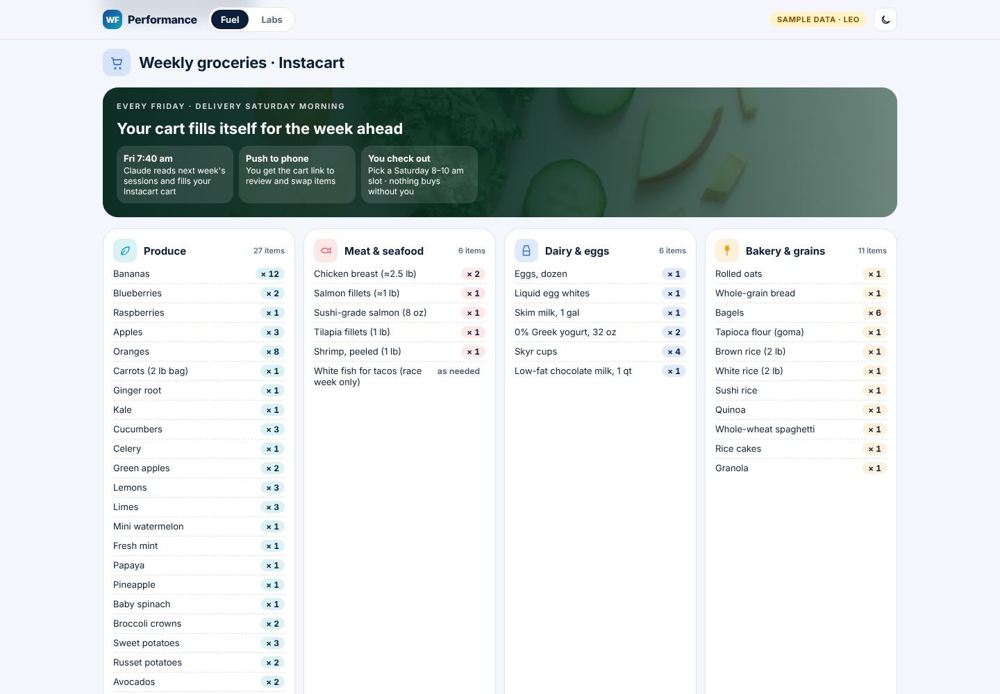
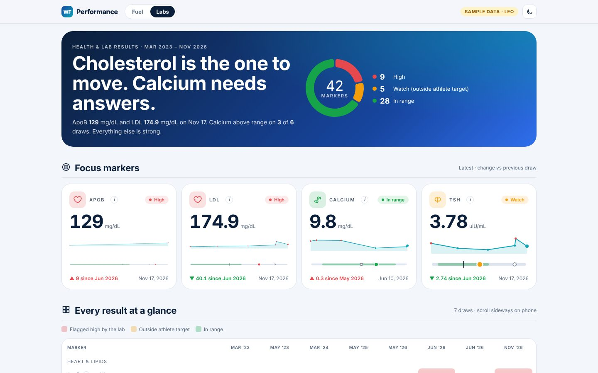
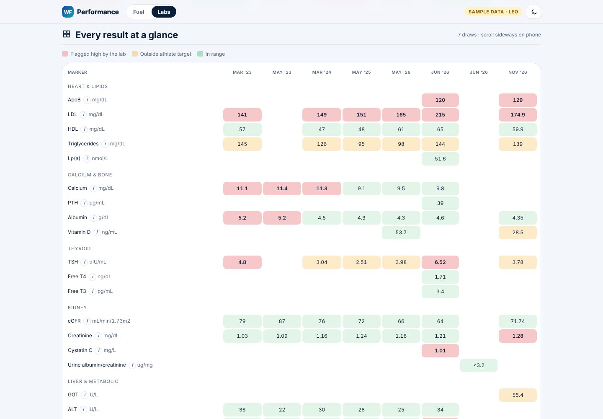
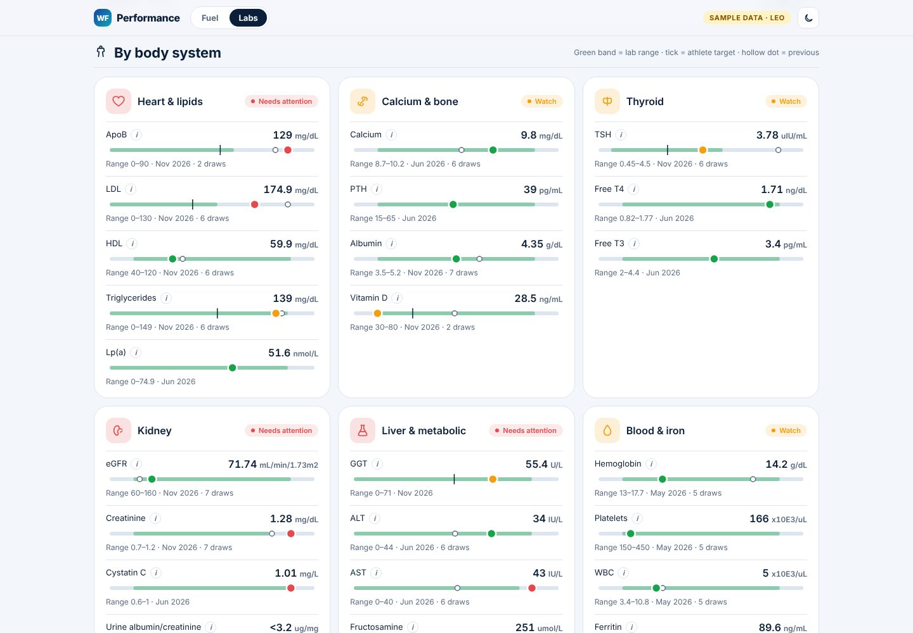
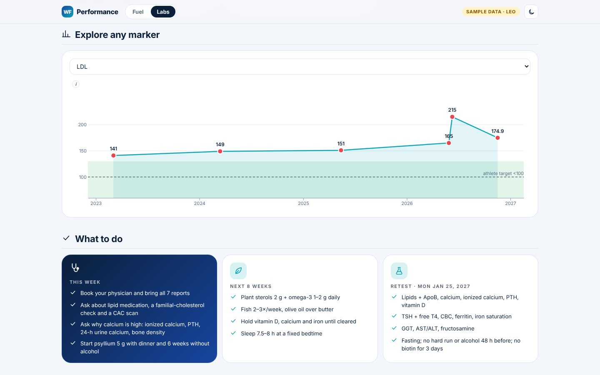

# Fuel & Labs

**Two companion apps for a marathon build.** Fuel turns every training day into carbs, protein, fat, meals, recipes and a weekly grocery cart. Labs turns seven blood panels into one clear view of what to fix.

- **Try them:** https://www.wendelfreitas.com/fuel-and-labs/app/
- **Case study:** https://www.wendelfreitas.com/fuel-and-labs/

## Screens

| Fuel · today | Fuel · menu | Fuel · the build | Fuel · groceries |
|---|---|---|---|
|  |  |  |  |
| **Labs · overview** | **Labs · heatmap** | **Labs · body systems** | **Labs · explore and act** |
|  |  |  |  |

## What each app does

**Fuel — Performance Nutrition Planner**
- A hero with a big date, the day's session and distance, Miami weather with a fluid tip, a 7-day selector and the day's carbs, protein, fat and energy.
- Targets in grams per kilo by session type (rest, easy, track, long run, race), a top-up the day before long runs of 24 km or more and before the race, and a 10 g/kg carb load for the last three days.
- The day's meals as photo cards with times, macro chips and a "How to prepare" recipe.
- The 22-week build as one row per week, grouped by phase: weekly km, average carbs per day, long run. Tap a week to plan it.
- A juice bar, the weekly grocery list by aisle, smart swaps for cholesterol and the rules that make it work.

**Labs — Health & Lab Results**
- A one-line verdict and a ring of 42 markers: flagged by the lab, outside the athlete target, in range.
- Focus markers with sparklines, a heatmap of every result from every draw, six body systems with range bars, a chart for any marker and a three-step action plan.
- An **i** button on every marker opens a plain-language card: what it is, why it matters for a runner, and a history written from the athlete's own results (first and latest value, trend, how often the lab flagged it, and where the latest result sits).

Both apps follow the system light or dark setting, install to the home screen and work on a 390-pixel phone.

## How the private version runs

The originals are Claude dashboards fed by the owner's data:

1. **Garmin weight.** Targets use the median of the last ten Garmin weigh-ins.
2. **Friday grocery agent.** A scheduled Claude task reads next week's sessions every Friday at 7:40 am, fills an Instacart cart and sends the checkout link. Checkout stays with the owner.
3. **Morning weather agent.** A daily 4:17 am task saves the Miami forecast the hero reads.
4. **Lab reports.** Claude read seven PDFs from two labs and normalized them into one table of marker, date, value, unit, range and flag.

## What is in here

| Path | Contents |
|---|---|
| `app/index.html` | Launcher for the two apps. |
| `app/fuel/`, `app/labs/` | Each app as one HTML file plus a web manifest. Data is inlined; d3 and Inter load from CDNs. |
| `app/assets/`, `app/fuel/img/` | Icons, the hero photo and the dish and juice images. |
| `src/` | The dashboard pages, `labs_info.js` (marker explanations and history),  `shim.js` (a small stand-in for the dashboard runtime) and the CSV data. |
| `scripts/build.py` | Builds both apps from `src/`. `--make-demo labs.csv` regenerates the shifted sample lab values. |
| `scripts/shoot.py`, `scripts/compose.py` | Headless Chrome screenshots and the cover, frames and thumbnails in `docs/`. |
| `scripts/build_site.py` | The trilingual case page in `site/` and the Cases card snippet. |

## Running

Serve `app/` with any static server (`python3 -m http.server -d app`) and open it. URL options: `?date=2026-11-24` opens Fuel on a day, `?theme=dark|light`, `?embed` hides the app bar.

## Deploy notes (wendelfreitas.com on GoDaddy)

- `app/` goes to `public_html/fuel-and-labs/app/`.
- `site/case-page.html` goes to `public_html/fuel-and-labs/index.html`.
- Paste `site/cases-app-card.snippet.html` before `</body>` in the site's `index.html`, next to the other case card scripts.

## Sample data and credits

The public build uses sample data for a demo athlete, Leo: 70 kg, a saved Miami forecast and lab values shifted 5–12% from the originals with flags recomputed. It is a design and product case, not medical advice.

Dish images are AI-generated. Photos from [Unsplash](https://unsplash.com): track by Max Di Capua, easy run by Sage Friedman, long run by Julien Laurent, race by Capstone Events, green juice by Guillermo Nolasco, orange juice by Alondra Lucia, watermelon juice by Rajasekhar R, beet juice by K15 Photos, runner at sunrise by Anthony Tuil, produce by Dose Juice.

Designed and directed by [Wendel de Freitas](https://www.wendelfreitas.com); written with Claude.
